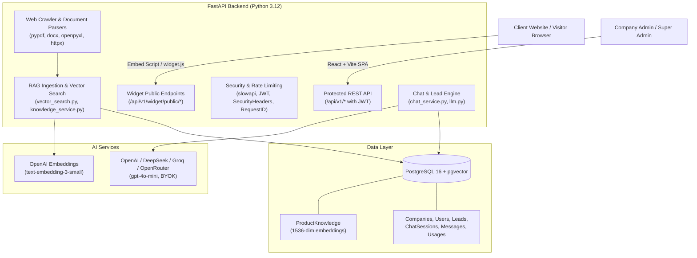
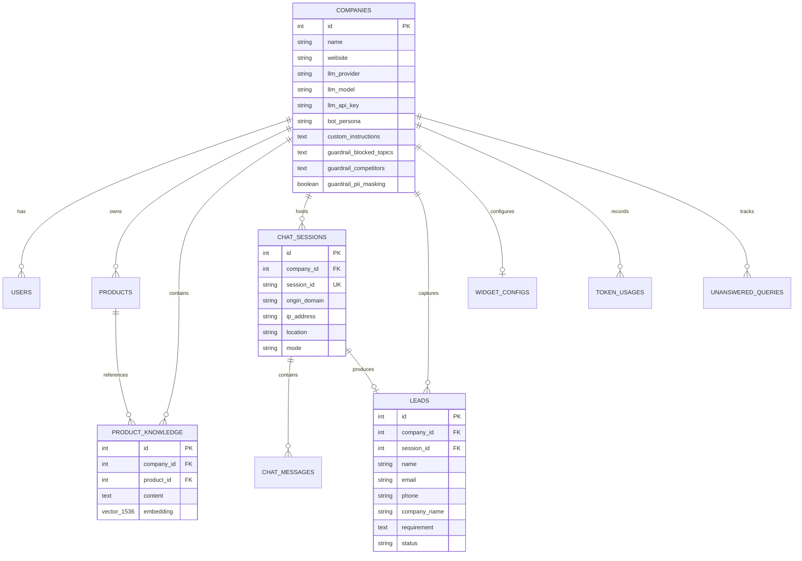

# AI Sales Bot - Technical Project Analysis & Architectural Review

## 1. Executive Summary

**AI Sales Bot** is an enterprise-grade, multi-tenant B2B conversational AI sales qualification and customer engagement platform. It bridges the gap between autonomous AI product sales agents and human sales teams.

The platform enables businesses to:
1. Embed an AI-powered sales assistant on any website with a single `<script>` tag.
2. Ingest structured and unstructured product knowledge (PDF, DOCX, XLSX, CSV, and live website crawling) into a vector database using `pgvector`.
3. Autonomously qualify leads by extracting 5 core lead criteria (Name, Email, Phone, Company, Requirement) across conversations using structured LLM outputs.
4. Seamlessly transition between autonomous AI conversation and **Live Human Takeover** when an agent wants to close a deal or handle complex queries.
5. Apply dynamic enterprise guardrails (competitor suppression, blocked topics, PII masking, tone calibration) and configurable bot personas.
6. Track token consumption, cost estimates, visitor geolocation, and pipeline performance across individual tenant companies and a global Super Admin view.

---

## 2. Architecture & Technology Stack

### 2.1 Backend Architecture
- **Framework**: [FastAPI](file:///d:/Project/AI-Sales-Bot/backend/app/main.py) (Asynchronous REST API)
- **Database ORM**: [SQLAlchemy 2.0](file:///d:/Project/AI-Sales-Bot/backend/app/database/connection.py) with dual connection engines:
  - `asyncpg` (`create_async_engine`) for non-blocking asynchronous request handling.
  - `psycopg2-binary` (`create_engine`) for synchronous operations, Alembic migrations, and seeding scripts.
- **Vector Database**: PostgreSQL 16 with `pgvector` extension for cosine distance vector similarity search.
- **VPS SSH Tunneling**: Native auto-tunneling in [connection.py](file:///d:/Project/AI-Sales-Bot/backend/app/database/connection.py) via `sshtunnel` and `paramiko` to tunnel local development to remote VPS PostgreSQL (`147.93.31.98:22`).
- **Authentication**: JWT tokens ([security.py](file:///d:/Project/AI-Sales-Bot/backend/app/core/security.py)) with SHA-256 HMAC and bcrypt password hashing.
- **Safety & Rate Limiting**: `slowapi` rate limiting with custom 429 handlers, `RequestIDMiddleware` for tracing, and `SecurityHeadersMiddleware`.

### 2.2 Frontend Architecture
- **Framework**: React 18 with Vite 5 ([frontend/package.json](file:///d:/Project/AI-Sales-Bot/frontend/package.json))
- **Design System**: Vanilla CSS design tokens ([index.css](file:///d:/Project/AI-Sales-Bot/frontend/src/index.css), [App.css](file:///d:/Project/AI-Sales-Bot/frontend/src/App.css)) with glassmorphism, responsive sidebar layout, and dark/light themes.
- **Icons**: `lucide-react`
- **State Management**: React Hooks with custom REST client ([client.js](file:///d:/Project/AI-Sales-Bot/frontend/src/api/client.js)).

### 2.3 Client Embed Widget
- **File**: [widget.js](file:///d:/Project/AI-Sales-Bot/backend/app/static/widget.js)
- **Footprint**: Standalone, vanilla JavaScript (no dependencies or bundlers required).
- **Features**: Floating launcher button (FAB), responsive chat modal, SVG & custom avatar rendering, markdown formatting, local session persistence, typing indicator, and live polling sync for human agent takeover.

---

## 3. Core Modules & Component Breakdown

| Module | Files | Description |
| :--- | :--- | :--- |
| **Authentication & Users** | [auth.py](file:///d:/Project/AI-Sales-Bot/backend/app/api/auth.py), [auth_service.py](file:///d:/Project/AI-Sales-Bot/backend/app/services/auth_service.py), [user.py](file:///d:/Project/AI-Sales-Bot/backend/app/models/user.py) | Registration, JWT login, token decoding, email verification, and password reset flows. |
| **Multi-Tenancy** | [companies.py](file:///d:/Project/AI-Sales-Bot/backend/app/api/companies.py), [company.py](file:///d:/Project/AI-Sales-Bot/backend/app/models/company.py) | Tenant isolation, BYOK API keys, LLM provider selection, custom instructions, and bot personas. |
| **RAG Knowledge Base** | [knowledge.py](file:///d:/Project/AI-Sales-Bot/backend/app/api/knowledge.py), [knowledge_service.py](file:///d:/Project/AI-Sales-Bot/backend/app/services/knowledge_service.py), [vector_search.py](file:///d:/Project/AI-Sales-Bot/backend/app/services/vector_search.py) | Stores 1536-dimension embeddings of product documentation. Cosine distance queries. |
| **Document Ingestion** | [document_parser.py](file:///d:/Project/AI-Sales-Bot/backend/app/services/document_parser.py) | Ingests PDF (`pypdf`), DOCX (`docx`), XLSX (`openpyxl`), CSV, and TXT files, chunks text, and vectorizes. |
| **Web Auto-Crawler** | [crawler_service.py](file:///d:/Project/AI-Sales-Bot/backend/app/services/crawler_service.py) | Asynchronously crawls public URLs via `httpx`, strips boilerplate HTML tags, chunks text, and embeds. |
| **Chat & AI Engine** | [chat.py](file:///d:/Project/AI-Sales-Bot/backend/app/api/chat.py), [chat_service.py](file:///d:/Project/AI-Sales-Bot/backend/app/services/chat_service.py), [llm.py](file:///d:/Project/AI-Sales-Bot/backend/app/ai/llm.py) | Handles conversation state, RAG query, OpenAI Structured Outputs parsing, and token tracking. |
| **Live Human Takeover** | [chat.py](file:///d:/Project/AI-Sales-Bot/backend/app/api/chat.py#L114), [ConversationsTab.jsx](file:///d:/Project/AI-Sales-Bot/frontend/src/components/ConversationsTab.jsx) | Real-time switch between AI mode and human agent mode, allowing live agents to respond to visitors. |
| **Lead Qualification** | [leads.py](file:///d:/Project/AI-Sales-Bot/backend/app/api/leads.py), [lead_service.py](file:///d:/Project/AI-Sales-Bot/backend/app/services/lead_service.py), [lead.py](file:///d:/Project/AI-Sales-Bot/backend/app/models/lead.py) | Automatically converts conversations with 5 verified fields into qualified leads with geolocation. |
| **Widget Studio** | [widget.py](file:///d:/Project/AI-Sales-Bot/backend/app/api/widget.py), [WidgetStudioTab.jsx](file:///d:/Project/AI-Sales-Bot/frontend/src/components/WidgetStudioTab.jsx) | Visual customizer for bot branding, site key generation, and origin domain authorization. |
| **Analytics & Usage** | [dashboard.py](file:///d:/Project/AI-Sales-Bot/backend/app/api/dashboard.py), [usage.py](file:///d:/Project/AI-Sales-Bot/backend/app/api/usage.py), [token_usage.py](file:///d:/Project/AI-Sales-Bot/backend/app/models/token_usage.py) | KPI dashboard, token consumption tracking per session/company, and USD cost estimation. |
| **Guardrails & Safety** | [GuardrailsTab.jsx](file:///d:/Project/AI-Sales-Bot/frontend/src/components/GuardrailsTab.jsx), [sales_assistant.py](file:///d:/Project/AI-Sales-Bot/backend/app/ai/prompts/sales_assistant.py) | Competitor filtering, forbidden topics, PII protection, refusal messaging, and interactive testing sandbox. |

---

## 4. Database Schema Overview

---

## 5. Key Strengths & Technical Highlights

1. **Structured Outputs for Lead Capture**:
   Instead of unreliable regex or loose JSON generation, the system uses OpenAI's `client.beta.chat.completions.parse` with Pydantic validation ([SalesAssistantResponse](file:///d:/Project/AI-Sales-Bot/backend/app/ai/llm.py#L26)). It automatically falls back to JSON mode for non-beta models.
2. **Context-Aware Historical Memory**:
   The sales prompt enforces memory across turns: if a visitor provides their name in turn 1 and requirement in turn 4, the LLM retains both and only asks for remaining missing information.
3. **Comprehensive Multi-Format Ingestion**:
   Supports native PDF parsing, Word doc extraction (including embedded tables), Excel sheets, CSV rows, and live webpage crawling with sentence-boundary chunking and 120-token overlapping windows.
4. **Knowledge Gap Feedback Loop**:
   When the bot cannot answer a visitor's question, it automatically logs an [UnansweredQuery](file:///d:/Project/AI-Sales-Bot/backend/app/models/unanswered_query.py). Administrators can review and resolve these queries directly in the UI, adding the answers to the knowledge base with one click.
5. **Zero-Friction Client Deployment**:
   The widget script requires only a `data-site-key` and script tag. It automatically negotiates CORS, respects allowed domains, generates unique visitor sessions, and supports live agent polling.

---

## 6. Recommendations & Areas for Improvement

### 6.1 Virtual Environment Dependencies
- **Finding**: Running pytest in the current `.venv` failed due to missing `pwdlib` and document ingestion packages (`pypdf`, `python-docx`, `openpyxl`).
- **Action**: Run `pip install -r backend/requirements.txt` inside `.venv` to synchronize local developer packages.

### 6.2 Real-Time Communication Upgrade (WebSockets / SSE)
- **Finding**: Live agent takeover polling ([widget.py:L200](file:///d:/Project/AI-Sales-Bot/backend/app/api/widget.py#L200)) uses HTTP `GET /public/chat/sync/{site_key}/{session_id}` every few seconds.
- **Action**: Transitioning to WebSockets or Server-Sent Events (SSE) will eliminate polling overhead and enable instantaneous bi-directional communication between visitor and live agent.

### 6.3 Async Background Workers for Ingestion & Crawling
- **Finding**: URL crawling and large multi-page PDF indexing execute directly within the FastAPI HTTP request lifecycle ([knowledge.py](file:///d:/Project/AI-Sales-Bot/backend/app/api/knowledge.py)).
- **Action**: Offload heavy indexing jobs to a background task queue (e.g., Celery, Redis + ARQ, or FastAPI `BackgroundTasks`) with status polling to prevent HTTP gateway timeouts on large files or slow websites.

### 6.4 Schema Migration Unification
- **Finding**: [main.py](file:///d:/Project/AI-Sales-Bot/backend/app/main.py#L70) executes inline `ALTER TABLE` queries during startup, while Alembic is also configured in [alembic/versions](file:///d:/Project/AI-Sales-Bot/backend/alembic/versions).
- **Action**: Formalize all database mutations into Alembic revisions to ensure clean version tracking, rollback capability, and CI/CD consistency.
